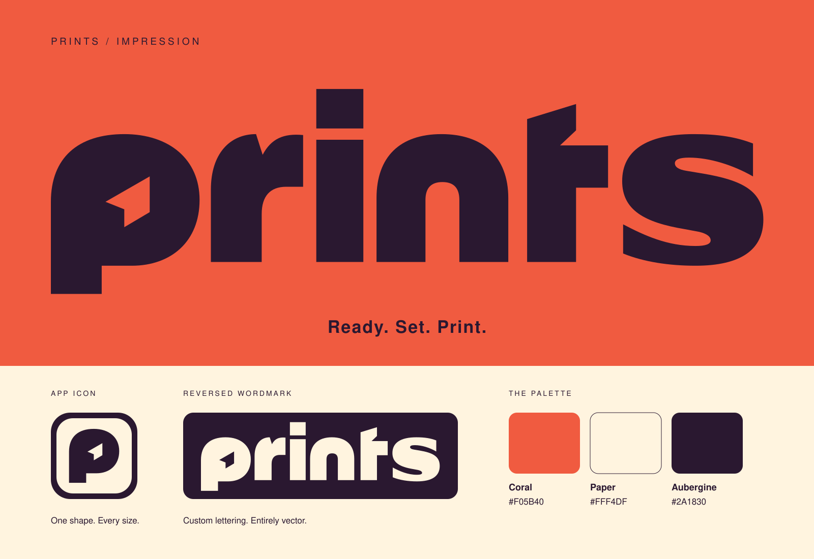

# PRINTS — Impression

The selected direction uses bold lowercase lettering with a square i dot, a paper-shaped counter in the p, and a matching diagonal cut in the t. The p is extracted directly from the wordmark so every application carries the same shape.

## Artwork

| Asset | Use |
| --- | --- |
| [`wordmark.svg`](../../public/wordmark.svg) | Aubergine lettering on a light surface; app header |
| [`wordmark-reverse.svg`](../../public/wordmark-reverse.svg) | Cream lettering on aubergine or another dark surface |
| [`symbol.svg`](../../public/symbol.svg) | Standalone p with a transparent counter and background |
| [`mark.svg`](../../public/mark.svg) | Cream rounded app tile; in-app identity |
| [`icon.svg`](../../public/icon.svg) | Favicon and ordinary application icon |
| [`icon-maskable.svg`](../../public/icon-maskable.svg) | Maskable PWA icon with a full-bleed cream background and inset symbol |
| [`impression.svg`](impression.svg) | Scalable presentation board using the actual production geometry |

The logo lettering consists entirely of SVG paths. It never depends on an installed font. Presentation-board captions use a system sans-serif; they are not part of the logo.

## Color and scale

| Color | Value | Role |
| --- | --- | --- |
| Coral | `#F05B40` | Expressive brand surfaces and primary buttons |
| Paper | `#FFF4DF` | Header, app tiles and reversed lettering |
| Aubergine | `#2A1830` | Logo and text, including text on coral |
| Terracotta | `#A93621` | Accessible control accents and focus rings on light surfaces |

Use the full wordmark at 88 CSS pixels wide or larger. Use the app icon at 16 CSS pixels or larger; the symbol should retain its paper-shaped counter. Preserve aspect ratio and leave at least the width of the i stem around the wordmark. On small screens, use the wordmark without an adjacent duplicate p.

Use coral as an accent around the working area, with warm neutral panels and aubergine text. The print sheet remains white so users can judge their work. The optional brand line is **Ready. Set. Print.**

## Maintenance

Run `npm run brand` to regenerate all six SVG assets and the SVG presentation board from `scripts/build-brand.mjs`. Refresh `impression.png` from the SVG board when the geometry changes. Keep the shape shared through the generator; do not independently redraw an icon or substitute a font for the wordmark.

The PWA manifest separates ordinary and maskable icons. The maskable version places the complete p inside the central 80% safe circle. Runtime identity assets are precached by the service worker for offline use.
